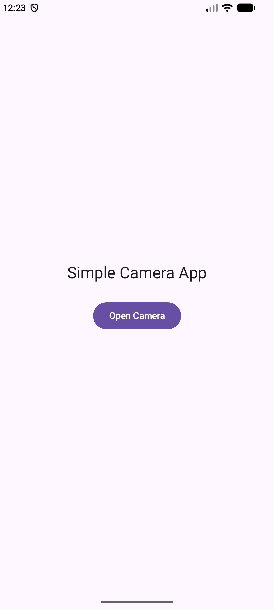
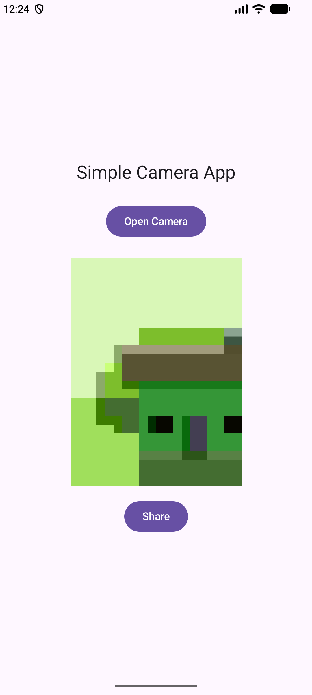
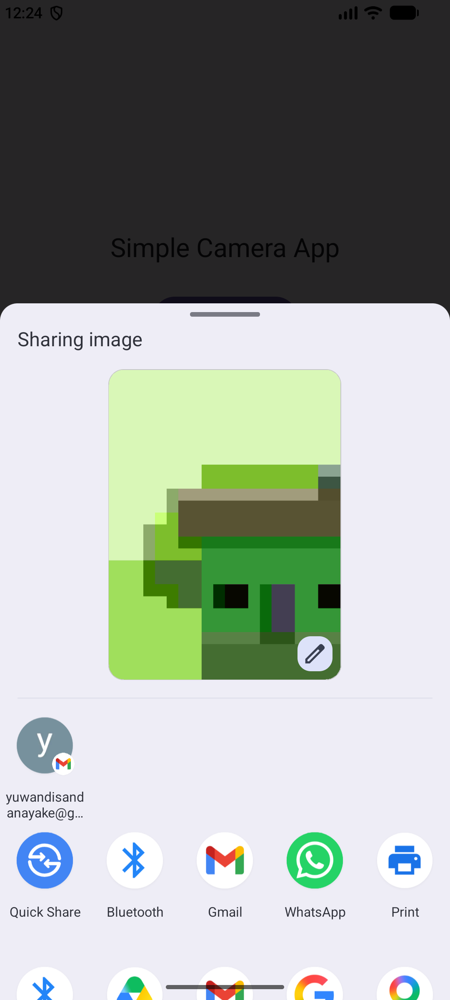

# Simple Camera App

A simple Android application built with Kotlin and Jetpack Compose. The app lets users capture a photo and share it using Android's system sharing interface.

## Features

- Open the device camera
- Capture a photo
- Display the captured photo in the app
- Share the captured photo using Android's system sharing interface

## Screenshots

Add your screenshots to the `screenshots` folder in the project.

### Camera screen
<!-- Add a screenshot of the app before taking a photo -->

### Captured photo
<!-- Add a screenshot showing the photo captured in the app -->

### Share interface
<!-- Add a screenshot of Android's sharing interface -->

## Technologies Used

- Kotlin
- Jetpack Compose
- Android Intents
- Android FileProvider

## How to Run

1. Clone or download this repository.
2. Open the project in Android Studio.
3. Allow Android Studio to sync the Gradle files.
4. Run the app on an Android device or emulator.
5. Tap the camera button to capture a photo.
6. View the captured photo in the app.
7. Tap the share button to open Android's sharing interface.

## Project Structure

- `MainActivity.kt` — contains the app's main screen and camera/share functionality.
- `res/xml/file_paths.xml` — defines the file paths that can be shared through `FileProvider`.
- `AndroidManifest.xml` — contains the app configuration and `FileProvider` declaration.

## Author

Your Name
